```{=typst}
#set text(size: 10.5pt)
#set par(leading: 0.65em, spacing: 0.55em)
#show raw: set text(size: 8pt)
#show heading: set block(above: 1.1em, below: 0.6em)
#align(center)[
  #v(22%)
  #text(size: 27pt, weight: "bold")[Bingeling:]
  #v(0.5cm)
  #text(size: 18pt)[A Video Streaming Database Using MongoDB]
  #v(2cm)
  #text(size: 15pt)[Upayan Mazumder]\
  #text(size: 13pt)[24BDS0367]\
  #text(size: 13pt)[BCSE302L – Database Systems]\
  #text(size: 11pt)[22 October 2026]
]
#pagebreak()
```

# Introduction and domain analysis

Bingeling is a small database for a sample video-streaming platform. Its catalogue contains movies and series. A user has a profile and a current subscription. The database also stores sample viewing activity, ratings, plan details, and payments. This case study uses MongoDB 7 and answers five simple and five complex questions with queries against populated collections.

A viewer could search titles by genre or actor and inspect recent activity. A catalogue team could compare genres by country. A subscription team could examine plan counts and monthly records. These tasks need different data shapes: title details belong together, while viewing events and payments grow as separate records. This project models the records and queries. It does not stream video.

# Database choice and design

MongoDB stores a title as one document with arrays for genres and cast. A series also embeds its seasons and episodes. These lists have a limited size and usually appear with the title. The `users` collection embeds profiles and one current `subscription`. An index can support searches across documents. Aggregation pipelines combine collections and calculate grouped results for Q6–Q10 [3].

The database keeps `watch_events`, `reviews`, and `payments` separate. A user can acquire many events, so embedding every event in a user document would make that document grow without a fixed limit. Event documents refer to users and titles by BSON `ObjectId`. The `titleName` copied into an event makes a history row easier to display, but it needs an update if a title name changes. MongoDB does not enforce these references as relational foreign keys.

| Collection | Purpose and key fields | Links |
|---|---|---|
| `users` | `_id`, `name`, `country`, `timezone`, `profiles`, current `subscription` | `_id` from events, reviews, payments |
| `titles` | `_id`, `type`, `name`, `releaseYear`, `genres`, `cast`, movie `runtimeMin` or series `seasons` | `_id` from events and reviews |
| `watch_events` | `userId`, `titleId`, `startedAt`, `minutesWatched`, `completed`, `device` | users and titles |
| `reviews` | `userId`, `titleId`, `rating`, `createdAt` | users and titles |
| `plans` | `name`, `priceInr`, `screens`, `maxQuality` | plan name in users and payments |
| `payments` | `userId`, `plan`, `amountInr`, `paidAt`, billing period | users and plans |

The loader imports Extended JSON arrays with `$oid` and `$date`, then installs validators and indexes. A compound index on `watch_events.userId` and `startedAt` suits Q4. The `titles.genres` and `releaseYear` index suits Q1. A unique `(titleId, userId)` review index limits one rating per user and title. Payment indexes cover plan and billing period. These indexes describe the implemented access paths. The report does not claim a measured speed gain.

# Data population

The seed script uses fixed seed `367`. It selects 400 movies from a September 2021 Netflix catalogue snapshot and matches them by title and year to MovieLens movie links. It also selects 100 series from the catalogue. The catalogue supplies names, cast, categories, and release years [1]. MovieLens 32M supplies anonymous user IDs, ratings, and rating timestamps [2]. The script stores 5,000 ratings as `reviews` with empty text.

The script generates names and `example.com` addresses for those anonymous IDs. It also generates countries, subscriptions, plans, billing records, devices, and series episodes. It uses 49,997 selected MovieLens rating rows to construct sample `watch_events` and adds three series events for one binge example. A rating timestamp is **not** a playback timestamp. For these movie records, a rating of at least 3 sets `completed` to true and `minutesWatched` to the movie runtime. Lower ratings produce a half-runtime record. The script generates the extra fields and sample viewing activity. It does not observe playback.

The script writes six Extended JSON arrays. `scripts/load.sh` imports them into `bingeling`, and `scripts/schema.js` adds validators and indexes. The checked-in arrays contain these counts:

| Collection | Documents |
|---|---:|
| `users` | 2,000 |
| `titles` | 500 |
| `watch_events` | 50,000 |
| `reviews` | 5,000 |
| `plans` | 3 |
| `payments` | 33,776 |

The following field excerpts come from the checked-in arrays. The first is a movie title. The second is a sample event. They omit other stored fields.

**Title excerpt**

```json
{
  "_id": {
    "$oid": "0200000000000000000009a8"
  },
  "type": "movie",
  "name": "Uncut Gems",
  "genres": [
    "Drama",
    "Thriller"
  ],
  "runtimeMin": 135
}
```

**Event excerpt**

```json
{
  "userId": {
    "$oid": "01000000000000000000571d"
  },
  "titleId": {
    "$oid": "0200000000000000000000c0"
  },
  "startedAt": {
    "$date": "2021-03-25T00:04:23Z"
  },
  "minutesWatched": 107,
  "completed": true,
  "origin": "movielens-rating-proxy"
}
```

The population screenshot records the MongoDB counts from the existing demonstration.

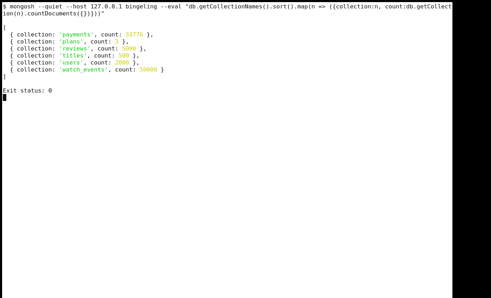{ width=100% }

# Dataset limits

MovieLens records ratings, not video plays. The generator assigns event duration, device, completion, user names, locations, subscriptions, and payments. It infers the `language` code from title country rather than verified audio data. The generator adds the binge example deliberately. Thus Q4 and Q6–Q10 illustrate database questions, not actual viewer behaviour or collected revenue. Q7 completion and rating are not independent: the generator uses rating to set many completion flags. The Netflix catalogue is a dated selection, not a current complete service catalogue.

# Five simple questions

## Q1. List all Thriller movies released after 2018, newest first.

A catalogue search uses a movie filter, the Thriller genre, and a release year after 2018. The query counts every match and displays at most ten titles in descending year order.

**Query** (`queries/simple/q01-thrillers-after-2018.js`):

```javascript
const filter = { type: 'movie', genres: 'Thriller', releaseYear: { $gt: 2018 } };
printjson({ totalMatches: db.titles.countDocuments(filter), showingNewest: 10 });
db.titles
  .find(filter, { name: 1, releaseYear: 1, genres: 1, language: 1 })
  .sort({ releaseYear: -1, name: 1 })
  .limit(10)
  .forEach((row) => printjson(EJSON.stringify(row)));
```

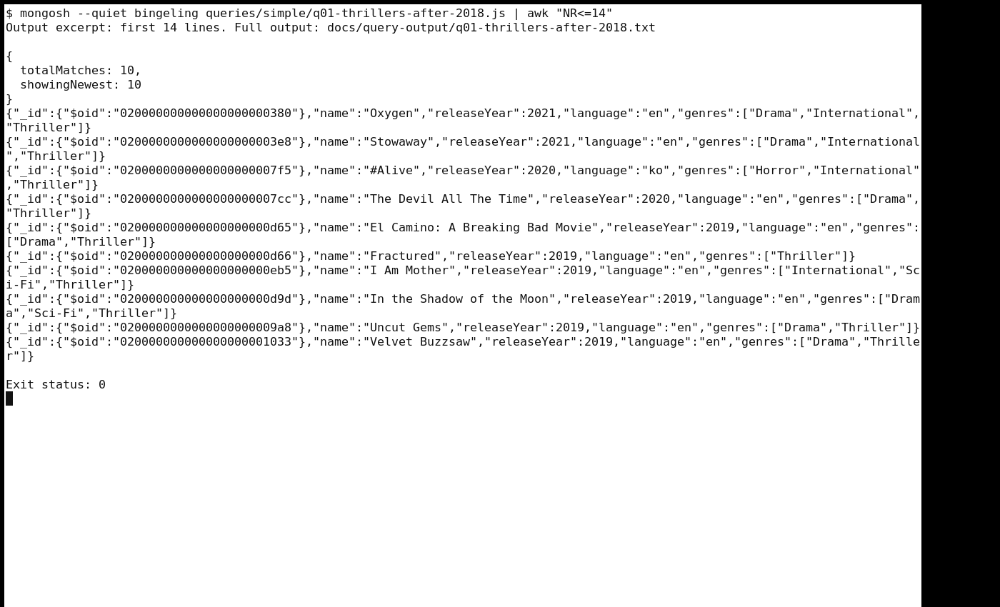{ width=100% }

**Answer.** The seed catalogue has **10** matching films. The newest displayed films are **Oxygen** and **Stowaway**, both from 2021.

## Q2. How many users have an active premium subscription?

This count checks two fields of the current subscription embedded in each user. A premium plan alone does not imply an active subscription.

**Query** (`queries/simple/q02-active-premium-count.js`):

```javascript
printjson({
  activePremiumUsers: db.users.countDocuments({
    'subscription.plan': 'premium',
    'subscription.status': 'active'
  })
});
```

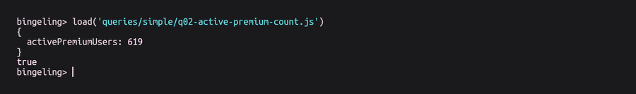{ width=100% }

**Answer.** The current seed snapshot contains **619 active premium users**.

## Q3. Which languages are in the catalogue?

The distinct operation lists the language codes stored in the title collection. These codes describe the generated catalogue field, not verified audio tracks.

**Query** (`queries/simple/q03-catalogue-languages.js`):

```javascript
printjson(db.titles.distinct('language').sort());
```

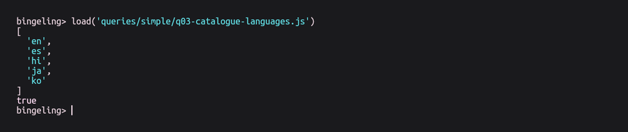{ width=100% }

**Answer.** The catalogue contains **5 language codes**: `en`, `es`, `hi`, `ja`, `ko`.

## Q4. Show the 10 most recent watch events of one user.

The manifest identifies one demo user. A filter on `userId`, descending sort on `startedAt`, and limit of ten display that user's latest stored events.

**Query** (`queries/simple/q04-recent-watches.js`):

```javascript
const demoUserId = ObjectId(
  JSON.parse(require('fs').readFileSync('data/manifest.json', 'utf8')).demoUserId
);
printjson({ userId: demoUserId, showingNewest: 10 });
db.watch_events
  .find(
    { userId: demoUserId },
    {
      titleName: 1,
      titleId: 1,
      startedAt: 1,
      minutesWatched: 1,
      completed: 1,
      device: 1,
      season: 1,
      episode: 1,
      origin: 1
    }
  )
  .sort({ startedAt: -1, _id: -1 })
  .limit(10)
  .forEach((row) => printjson(EJSON.stringify(row)));
```

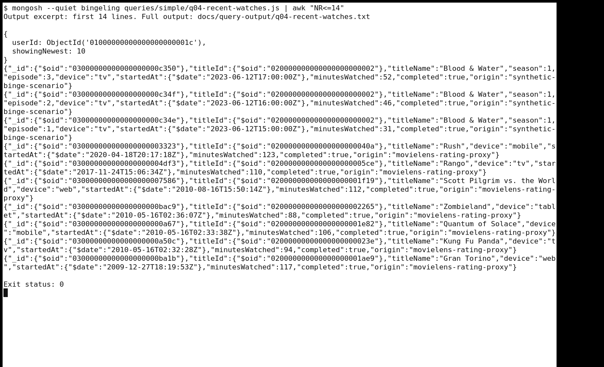{ width=100% }

**Answer.** For the selected user, the three newest stored events are episodes 3, 2, and 1 of **Blood & Water** on 12 June 2023. They are the explicit sample binge scenario.

## Q5. Find titles that feature a given actor.

The embedded `cast` array lets a title search match the selected actor. The query also counts all matches, then displays at most ten alphabetically.

**Query** (`queries/simple/q05-titles-by-actor.js`):

```javascript
const demoActor = JSON.parse(require('fs').readFileSync('data/manifest.json', 'utf8')).demoActor;
const filter = { cast: { $elemMatch: { name: demoActor } } };
printjson({ actor: demoActor, totalMatches: db.titles.countDocuments(filter), showingFirst: 10 });
db.titles
  .find(filter, { name: 1, type: 1, releaseYear: 1, cast: 1 })
  .sort({ name: 1 })
  .limit(10)
  .forEach((row) => printjson(EJSON.stringify(row)));
```

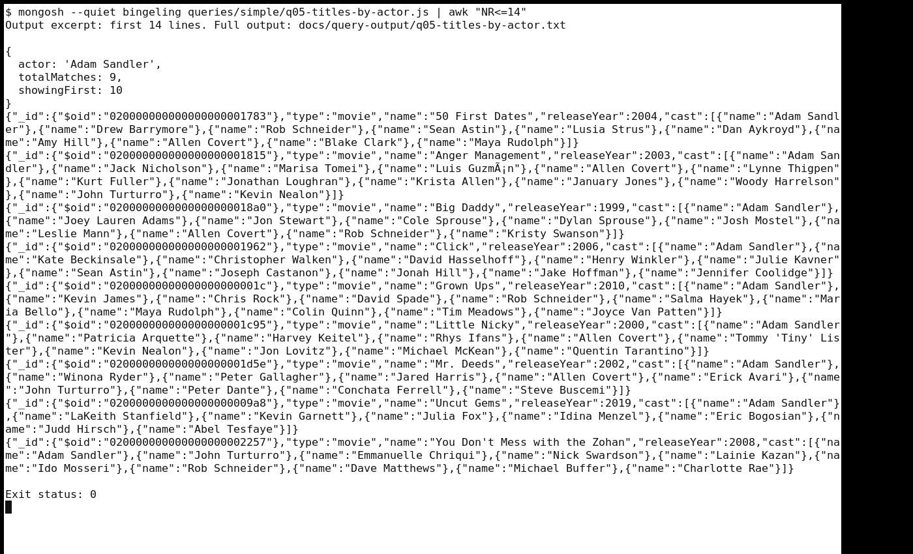{ width=100% }

**Answer.** **Adam Sandler** appears in **9** matching titles. The first displayed title in alphabetical order is **50 First Dates**.

# Five complex questions

## Q6. What are the top 5 genres by total watch minutes in each country?

The pipeline joins each event to its user and title. It groups minutes by user country and title genre, then ranks five genres per country. A title with several genres contributes its minutes to each genre.

**Query** (`queries/complex/q06-top-genres-by-country.js`):

```javascript
const countries = db.watch_events
  .aggregate([
    { $lookup: { from: 'users', localField: 'userId', foreignField: '_id', as: 'user' } },
    { $unwind: '$user' },
    { $lookup: { from: 'titles', localField: 'titleId', foreignField: '_id', as: 'title' } },
    { $unwind: '$title' },
    { $unwind: '$title.genres' },
    {
      $group: {
        _id: { country: '$user.country', genre: '$title.genres' },
        totalMinutes: { $sum: '$minutesWatched' },
        watchEvents: { $sum: 1 }
      }
    },
    {
      $group: {
        _id: '$_id.country',
        topGenres: {
          $topN: {
            n: 5,
            sortBy: { totalMinutes: -1, '_id.genre': 1 },
            output: {
              genre: '$_id.genre',
              totalMinutes: '$totalMinutes',
              watchEvents: '$watchEvents'
            }
          }
        }
      }
    },
    { $project: { _id: 0, country: '$_id', topGenres: 1 } },
    { $sort: { country: 1 } }
  ])
  .toArray();
printjson({ countries: countries.length, genresPerCountry: 5 });
countries.forEach((row) => printjson(EJSON.stringify(row)));
```

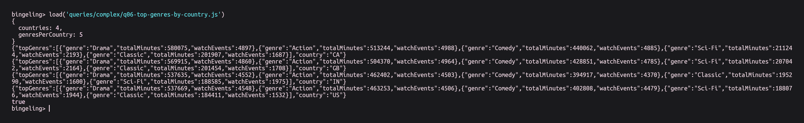{ width=100% }

**Answer.** **Drama** ranks first in each of the four assigned countries. For India, it totals **537,635 generated watch minutes**. Action and Comedy rank next in India's output.

## Q7. What is the completion rate of each movie, with average rating?

Two separate lookups collect watch counts and review averages for each movie. Separate groups avoid multiplying rows when a title has several watches and reviews. Completion rate equals completed watch records divided by all watch records, multiplied by 100. The query displays the first 20 movies after sorting by that rate.

**Query** (`queries/complex/q07-completion-vs-rating.js`):

```javascript
const movies = db.titles
  .aggregate([
    { $match: { type: 'movie' } },
    {
      $lookup: {
        from: 'watch_events',
        let: { titleId: '$_id' },
        pipeline: [
          { $match: { $expr: { $eq: ['$titleId', '$$titleId'] } } },
          {
            $group: {
              _id: null,
              watches: { $sum: 1 },
              completedWatches: { $sum: { $cond: ['$completed', 1, 0] } }
            }
          }
        ],
        as: 'watchStats'
      }
    },
    {
      $lookup: {
        from: 'reviews',
        let: { titleId: '$_id' },
        pipeline: [
          { $match: { $expr: { $eq: ['$titleId', '$$titleId'] } } },
          { $group: { _id: null, averageRating: { $avg: '$rating' }, reviewCount: { $sum: 1 } } }
        ],
        as: 'reviewStats'
      }
    },
    {
      $set: {
        watchStats: { $first: '$watchStats' },
        reviewStats: { $first: '$reviewStats' }
      }
    },
    {
      $project: {
        _id: 0,
        title: '$name',
        releaseYear: 1,
        watches: { $ifNull: ['$watchStats.watches', 0] },
        completedWatches: { $ifNull: ['$watchStats.completedWatches', 0] },
        completionRatePct: {
          $cond: [
            { $gt: ['$watchStats.watches', 0] },
            {
              $round: [
                {
                  $multiply: [
                    { $divide: ['$watchStats.completedWatches', '$watchStats.watches'] },
                    100
                  ]
                },
                2
              ]
            },
            null
          ]
        },
        reviewCount: { $ifNull: ['$reviewStats.reviewCount', 0] },
        averageRating: { $round: ['$reviewStats.averageRating', 2] }
      }
    },
    { $sort: { completionRatePct: -1, title: 1 } }
  ])
  .toArray();
printjson({ totalMovies: movies.length, showingFirst: Math.min(20, movies.length) });
movies.slice(0, 20).forEach((row) => printjson(EJSON.stringify(row)));
```

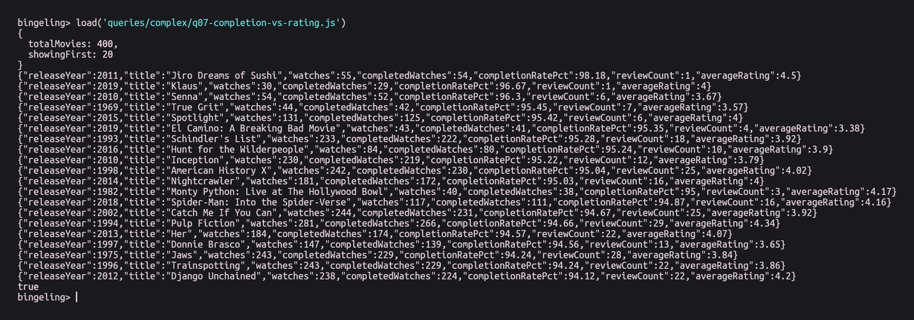{ width=100% }

**Answer.** The output covers **400 movies** and displays the first 20. **Jiro Dreams of Sushi** leads this displayed order with **54 completed records out of 55**, or **98.18%**. Its 1 review has an average rating of 4.5 out of 5.

## Q8. Which users binge-watched (3 or more episodes of one series on one day)?

The pipeline joins events with users and series titles. It converts timestamps to each user's local day and groups by user, series, season, and episode. It removes repeated plays before counting distinct episodes. The final result reports the match count and displays at most 25 groups.

**Query** (`queries/complex/q08-binge-watchers.js`):

```javascript
const result = db.watch_events
  .aggregate([
    { $match: { completed: true, season: { $exists: true }, episode: { $exists: true } } },
    { $lookup: { from: 'users', localField: 'userId', foreignField: '_id', as: 'user' } },
    { $unwind: '$user' },
    { $lookup: { from: 'titles', localField: 'titleId', foreignField: '_id', as: 'title' } },
    { $unwind: '$title' },
    { $match: { 'title.type': 'series' } },
    {
      $set: {
        localDay: {
          $dateTrunc: {
            date: '$startedAt',
            unit: 'day',
            timezone: '$user.timezone'
          }
        }
      }
    },
    {
      $group: {
        _id: {
          userId: '$userId',
          titleId: '$titleId',
          localDay: '$localDay',
          season: '$season',
          episode: '$episode'
        },
        name: { $first: '$user.name' },
        timezone: { $first: '$user.timezone' },
        title: { $first: '$title.name' }
      }
    },
    {
      $group: {
        _id: { userId: '$_id.userId', titleId: '$_id.titleId', localDay: '$_id.localDay' },
        user: { $first: '$name' },
        timezone: { $first: '$timezone' },
        series: { $first: '$title' },
        distinctEpisodes: { $sum: 1 },
        episodes: { $push: { season: '$_id.season', episode: '$_id.episode' } }
      }
    },
    { $match: { distinctEpisodes: { $gte: 3 } } },
    {
      $project: {
        _id: 0,
        userId: '$_id.userId',
        titleId: '$_id.titleId',
        user: 1,
        series: 1,
        localDay: '$_id.localDay',
        timezone: 1,
        distinctEpisodes: 1,
        episodes: 1
      }
    },
    { $sort: { distinctEpisodes: -1, localDay: -1, user: 1 } },
    {
      $facet: {
        matches: [{ $count: 'count' }],
        rows: [{ $limit: 25 }]
      }
    }
  ])
  .toArray()[0];
printjson({ totalBinges: result.matches[0]?.count || 0, showingTop: result.rows.length });
result.rows.forEach((row) => printjson(EJSON.stringify(row)));
```

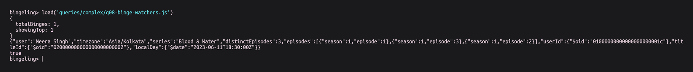{ width=100% }

**Answer.** The query finds **one qualifying group**. The generated user **Meera Singh** has three distinct completed episodes of **Blood & Water**. All three fall on 12 June 2023 in the Asia/Kolkata time zone.

## Q9. What is the monthly revenue and churn per plan?

The pipeline adds generated payment amounts by plan and UTC payment month. It joins plan prices and counts users by their current plan. Churn rate equals cancellations in that month divided by users active at the month's start, multiplied by 100. A zero denominator returns null. Only months with payments appear, and the query displays the first 20 plan-month rows.

**Query** (`queries/complex/q09-revenue-and-churn.js`):

```javascript
// Collections: payments, plans, users. Months shown have at least one payment.
const monthly = db.payments
  .aggregate([
    {
      $group: {
        _id: {
          plan: '$plan',
          month: { $dateTrunc: { date: '$paidAt', unit: 'month', timezone: 'UTC' } }
        },
        revenueInr: { $sum: '$amountInr' },
        payments: { $sum: 1 }
      }
    },
    { $lookup: { from: 'plans', localField: '_id.plan', foreignField: 'name', as: 'planDetails' } },
    { $unwind: '$planDetails' },
    { $set: { nextMonth: { $dateAdd: { startDate: '$_id.month', unit: 'month', amount: 1 } } } },
    {
      $lookup: {
        from: 'users',
        let: { plan: '$_id.plan', month: '$_id.month', nextMonth: '$nextMonth' },
        pipeline: [
          { $match: { $expr: { $eq: ['$subscription.plan', '$$plan'] } } },
          {
            $facet: {
              activeAtMonthStart: [
                {
                  $match: {
                    $expr: {
                      $and: [
                        { $lte: ['$subscription.startedAt', '$$month'] },
                        {
                          $or: [
                            { $eq: ['$subscription.endedAt', null] },
                            { $gt: ['$subscription.endedAt', '$$month'] }
                          ]
                        }
                      ]
                    }
                  }
                },
                { $count: 'count' }
              ],
              cancelledDuringMonth: [
                {
                  $match: {
                    $expr: {
                      $and: [
                        { $eq: ['$subscription.status', 'cancelled'] },
                        { $gte: ['$subscription.endedAt', '$$month'] },
                        { $lt: ['$subscription.endedAt', '$$nextMonth'] }
                      ]
                    }
                  }
                },
                { $count: 'count' }
              ]
            }
          }
        ],
        as: 'subscriberStats'
      }
    },
    {
      $set: {
        activeAtMonthStart: {
          $ifNull: [{ $first: { $first: '$subscriberStats.activeAtMonthStart' } }, null]
        },
        cancelledDuringMonth: {
          $ifNull: [{ $first: { $first: '$subscriberStats.cancelledDuringMonth' } }, null]
        }
      }
    },
    {
      $set: {
        activeAtMonthStart: { $ifNull: ['$activeAtMonthStart.count', 0] },
        cancelledDuringMonth: { $ifNull: ['$cancelledDuringMonth.count', 0] }
      }
    },
    {
      $project: {
        _id: 0,
        month: '$_id.month',
        plan: '$_id.plan',
        planPriceInr: '$planDetails.priceInr',
        payments: 1,
        revenueInr: 1,
        activeAtMonthStart: 1,
        cancelledDuringMonth: 1,
        churnRatePct: {
          $cond: [
            { $gt: ['$activeAtMonthStart', 0] },
            {
              $round: [
                { $multiply: [{ $divide: ['$cancelledDuringMonth', '$activeAtMonthStart'] }, 100] },
                2
              ]
            },
            null
          ]
        }
      }
    },
    { $sort: { month: 1, plan: 1 } }
  ])
  .toArray();
printjson({ totalPlanMonths: monthly.length, showingFirst: Math.min(20, monthly.length) });
monthly.slice(0, 20).forEach((row) => printjson(EJSON.stringify(row)));
```

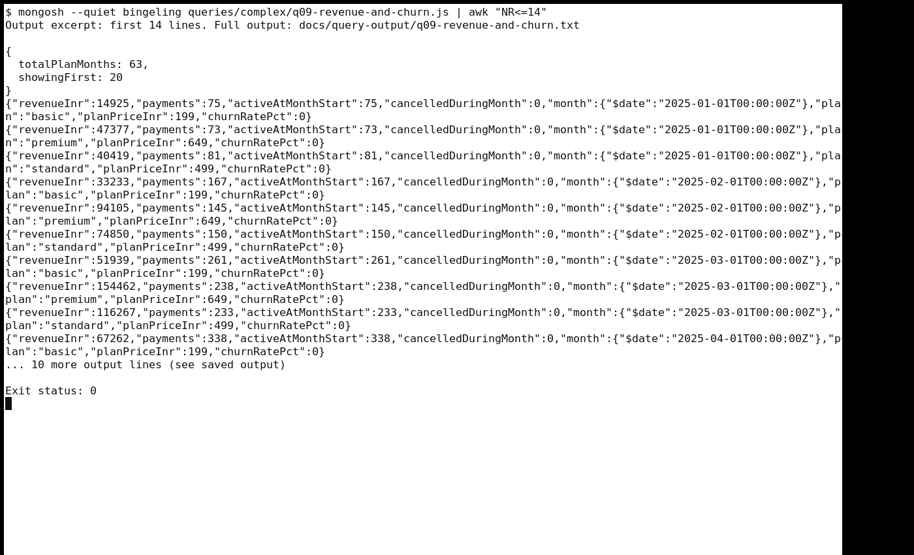{ width=100% }

**Answer.** The query finds **63 plan-month rows** and displays the first 20. In January 2025, the premium plan has **₹47,377 in generated payments** from 73 payments. It has 0 cancellations among 73 users active at the month start, so its reported churn rate is 0%.

## Q10. How does device usage change by hour of day?

The pipeline joins each event to its user's time zone and extracts the local hour. It groups events and minutes by device and hour. A window calculation tracks each device's cumulative share across hours 0–23. Four six-hour buckets show totals by daypart.

**Query** (`queries/complex/q10-device-usage-by-hour.js`):

```javascript
// Collections: watch_events, users (IANA timezone per user).
const usage = db.watch_events
  .aggregate([
    { $lookup: { from: 'users', localField: 'userId', foreignField: '_id', as: 'user' } },
    { $unwind: '$user' },
    { $set: { localHour: { $hour: { date: '$startedAt', timezone: '$user.timezone' } } } },
    {
      $facet: {
        hourlyByDevice: [
          {
            $group: {
              _id: { device: '$device', hour: '$localHour' },
              events: { $sum: 1 },
              minutesWatched: { $sum: '$minutesWatched' }
            }
          },
          {
            $setWindowFields: {
              partitionBy: '$_id.device',
              sortBy: { '_id.hour': 1 },
              output: {
                runningEvents: { $sum: '$events', window: { documents: ['unbounded', 'current'] } },
                deviceEvents: { $sum: '$events', window: { documents: ['unbounded', 'unbounded'] } }
              }
            }
          },
          {
            $project: {
              _id: 0,
              device: '$_id.device',
              hour: '$_id.hour',
              events: 1,
              minutesWatched: 1,
              runningEvents: 1,
              runningSharePct: {
                $round: [{ $multiply: [{ $divide: ['$runningEvents', '$deviceEvents'] }, 100] }, 2]
              }
            }
          },
          { $sort: { hour: 1, device: 1 } }
        ],
        dayparts: [
          {
            $bucket: {
              groupBy: '$localHour',
              boundaries: [0, 6, 12, 18, 24],
              output: { events: { $sum: 1 }, minutesWatched: { $sum: '$minutesWatched' } }
            }
          },
          {
            $project: {
              _id: 0,
              startHour: '$_id',
              daypart: {
                $switch: {
                  branches: [
                    { case: { $eq: ['$_id', 0] }, then: 'night (00–06)' },
                    { case: { $eq: ['$_id', 6] }, then: 'morning (06–12)' },
                    { case: { $eq: ['$_id', 12] }, then: 'afternoon (12–18)' }
                  ],
                  default: 'evening (18–24)'
                }
              },
              events: 1,
              minutesWatched: 1
            }
          }
        ]
      }
    }
  ])
  .toArray()[0];
printjson({ hourlyDeviceRows: usage.hourlyByDevice.length, dayparts: usage.dayparts.length });
const byHour = new Map();
for (const row of usage.hourlyByDevice) {
  if (!byHour.has(row.hour)) byHour.set(row.hour, []);
  byHour.get(row.hour).push(row);
}
for (const [hour, devices] of byHour) printjson(EJSON.stringify({ hour, devices }));
usage.dayparts.forEach((row) => printjson(EJSON.stringify(row)));
```

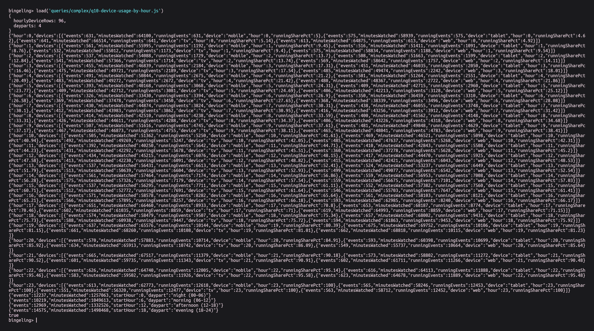{ width=100% }

**Answer.** The query produces **96 device-hour groups** and four dayparts. The **evening (18–24)** bucket has the most generated records: **14,575 events** and **1,498,468 minutes**.

# Findings and limitations

The seed catalogue returns ten Thriller films after 2018 and five stored language codes. The current subscription snapshot contains 619 active premium users. Drama leads the genre-minute ranking in each of the four assigned countries. The single detected binge group is the inserted three-episode example. The Q10 evening bucket contains 14,575 generated events. These are answers for this seed, not estimates for a streaming service.

The constructed events cannot measure real viewing time, completion, geography, or device choice. The Q9 payment totals and churn describe generated subscriptions. Q9 uses the current plan and its start and end dates, so it cannot reconstruct a subscriber's past plan changes. Only the first 20 of 63 plan-month rows appear in that query's displayed output.

# Conclusion

The six MongoDB collections store a catalogue, users, sample activity, ratings, plans, and payments. Five simple queries filter, count, or list documents. Five pipelines join collections and calculate grouped measures. The recorded outputs and screenshots show the implementation for this case study. The generated fields limit what its numbers can say about real viewers.

# References

[1] S. Bansal, “Netflix Movies and TV Shows,” Kaggle, September 2021. [Online]. Available: https://www.kaggle.com/datasets/shivamb/netflix-shows (CC0 catalogue snapshot).

[2] GroupLens Research, “MovieLens 32M Dataset,” University of Minnesota. [Online]. Available: https://grouplens.org/datasets/movielens/32m/ and https://files.grouplens.org/datasets/movielens/ml-32m-README.html. Research and redistribution must follow the GroupLens terms. Commercial use requires permission. GroupLens and the University of Minnesota do not endorse Bingeling. See also F. M. Harper and J. A. Konstan, “The MovieLens Datasets: History and Context,” *ACM Transactions on Interactive Intelligent Systems*, vol. 5, no. 4, 2015, doi:10.1145/2827872.

[3] MongoDB, “Data Modeling Best Practices.” [Online]. Available: https://www.mongodb.com/docs/manual/data-modeling/best-practices/.
